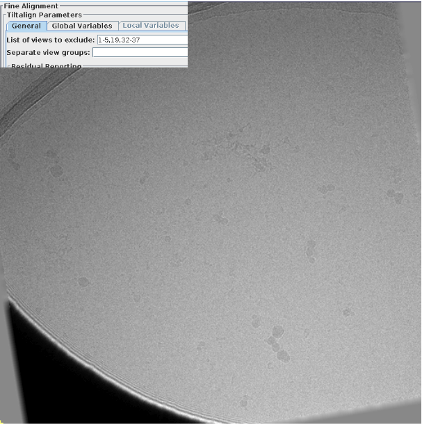
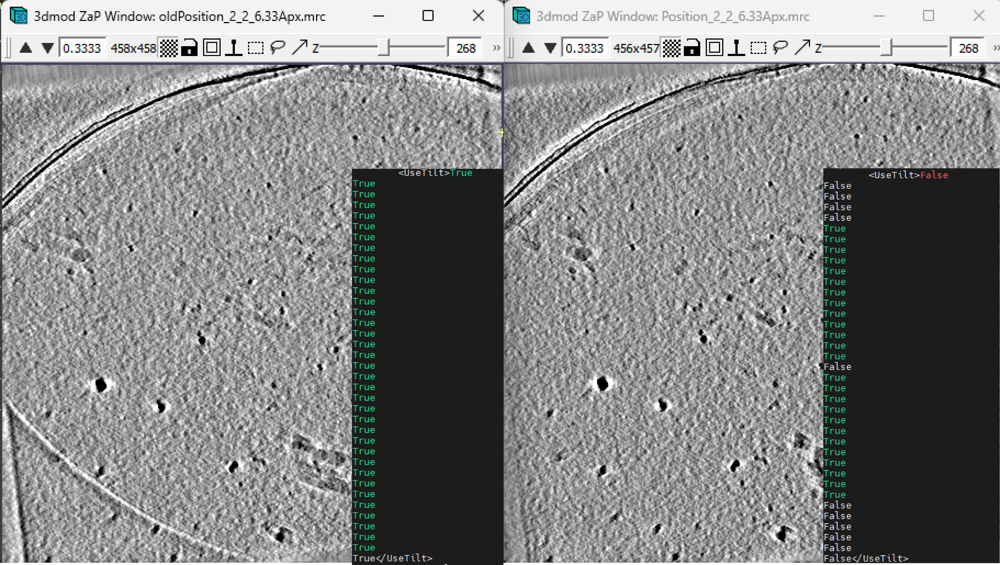

# skipped-views — Removing Skipped Views in etomo from WarpTools

Part of [tomo_toolshed](../README.md). A utility for processing XML files in
cryo-electron tomography workflows, designed to update `UseTilt` values based on
tilt alignment solutions from WARP.

## Overview

This tool processes XML files and updates their `UseTilt` values based on data
from corresponding `taSolution.log` files. It's particularly useful for:

- Removing skipped views from tilt series based on etomo alignment logs that are created in fine-alignment step
- Setting specific numbers of views to keep based on dose values, lowest accumulated doses are also the lowest tilts
- Setting all views to True for testing purposes or just going back to default
- Batch processing multiple XML files with automatic backups

This is needed when there are views that need to be excluded from the tomogram:


*Figure: Example of the view that need to be skipped.*

By turning the UseTilt to False for that view, the shadow goes away:



*Figure: Result after removing skipped views using this code, the UseTilt section of the xml file is also shown.*

## Features

- **Automatic backup creation** - Backs up original files before modification; existing backups are never overwritten (a numbered `.bak.1`, `.bak.2`, … is used)
- **etomo-based filtering** - Uses `taSolution.log` files to determine which views to keep
- **Dose-based selection** - Option to keep only the N lowest-dose views
- **Tilt-based selection** - Option to keep only until a certain amount of tilt from the first view
- **Delete mode** - Optionally remove excluded tilts outright from the XML and `.tomostar` (`--delete`), with a `--dry-run` preview
- **Batch processing** - Process multiple XML files with customizable patterns
- **mdoc doses** - Optionally take per-tilt doses from SerialEM `.mdoc` files (`--mdoc-dir`), overriding the XML/tomostar values with a warning where they differ
- **etomo tilt angles** - Optionally set the XML and tomostar tilt angles to etomo's refined values from `taSolution.log` (`--angles-from-log`)
- **Warp 1 and Warp 2** - Reads Warp 1 (UTF-16, CRLF) and Warp 2 (UTF-8) tilt-series XML
- **Byte-exact XML** - XML round-trips unchanged (encoding, BOM, declaration, line endings and spacing preserved); edits are written atomically

## Installation

Install the whole toolshed (see the [root README](../README.md)):

```bash
git clone https://github.com/hamid13r/tomo_toolshed.git
cd tomo_toolshed
pip install -e .
```

This provides the `tomo_toolshed` command; the tool below is the
`skipped-views` subcommand.

## Usage

### Basic Commands

```bash
# Process with custom pattern and directories, this would work in the warp_tiltseries directory in the default WarpTools structure
tomo_toolshed skipped-views --xml-dir ./ --xml-pattern "*.xml" --backup-dir backup_xml --tiltstack-dir tiltstack

# Set all UseTilt values to True
tomo_toolshed skipped-views --xml-dir ./ --xml-pattern "*.xml" --backup-dir backup_xml --all-true

# Keep only 20 lowest-dose tilts
tomo_toolshed skipped-views --xml-dir ./ --xml-pattern "*.xml" --backup-dir backup_xml --n-tilts 20

# Delete mode: physically remove the excluded tilts from the XML *and* the
# matching .tomostar (preview first with --dry-run)
tomo_toolshed skipped-views --xml-dir ./ --tiltstack-dir tiltstack --delete --tomostar-dir ../tomostar --dry-run
tomo_toolshed skipped-views --xml-dir ./ --tiltstack-dir tiltstack --delete --tomostar-dir ../tomostar

# Warp 1 project (XML like X.mrc.xml, etomo runs in imod/X.mrc/), with doses
# corrected from the SerialEM mdocs
tomo_toolshed skipped-views --xml-dir ./ --tiltstack-dir imod --mdoc-dir mdocs --dry-run

# ...and also make the XML / tomostar tilt angles match taSolution.log
tomo_toolshed skipped-views --xml-dir ./ --tiltstack-dir imod --mdoc-dir mdocs \
    --angles-from-log --tomostar-dir tomostar --dry-run
```

### Command Line Options

| Option | Default | Description |
|--------|---------|-------------|
| `--xml-dir` | `./` | Directory containing XML files to process |
| `--xml-pattern` | `*.xml` | Glob pattern to match XML files |
| `--backup-dir` | `backup_xml` | Directory to store XML backups |
| `--tiltstack-dir` | `tiltstack` | Base directory containing tiltstack logs |
| `--tomostar-dir` | `../tomostar` | Directory containing `.tomostar` files (delete mode) |
| `--all-true` | False | Set all UseTilt values to True (ignores log files) |
| `--n-tilts` | 0 | Keep N lowest-dose views, set others to False |
| `--max-tilt` | 0 | Keep views up to this tilt from the lowest tilt |
| `--delete` | False | Physically remove excluded tilts from the XML **and** `.tomostar`, instead of flipping `UseTilt` |
| `--dry-run` | False | Report what would change and write nothing |
| `--mdoc-dir` | (none) | Directory of SerialEM `.mdoc` files; per-tilt doses from the mdoc override the XML `<Dose>` and the `.tomostar` `_wrpDose` |
| `--angles-from-log` | False | Set the tilt angles of the views in `taSolution.log` to etomo's values, in the XML `<Angles>` and the `.tomostar` `_wrpAngleTilt` |

Two modes share the same selection (`--all-true` / `--n-tilts` / `--max-tilt`):

- **Flip mode** (default) rewrites `UseTilt` to `True`/`False`.
- **Delete mode** (`--delete`) physically removes the excluded tilts from every
  per-tilt structure in the XML (lists, indexed elements, and grid Z-slices,
  renumbered to stay contiguous) and the matching rows of the `.tomostar`
  (matched by movie name, falling back to row order with a warning).

## Processing Modes

### 1. Log-based Filtering (Default)
When `--n-tilts 0` (default):
- Views present in `taSolution.log` → `UseTilt = True`
- Views not in log → `UseTilt = False`

If etomo local alignments were used, `taSolution.log` contains the global
solution table followed by one table per local area. Only the first (global)
table is read.

### 2. Dose-based Selection
When `--n-tilts > 0`:
- Sorts tilts by dose values from XML (or from the mdoc with `--mdoc-dir`)
- Sets the N lowest-dose tilts to `True`
- Sets remaining tilts to `False`
- **Note**: Views not in taSolution.log are always set to `False`

### 3. Tilt-based Selection
When `--max-tilt > 0`:
- Finds the minimum-dose view and its tilt angle
- Keeps views (present in the log) within `--max-tilt` degrees of that tilt
- Sets everything else to `False`

### 4. All True Mode
When `--all-true`:
- Sets all `UseTilt` values to `True`
- Useful for testing or resetting configurations

### 5. Delete Mode
When `--delete`:
- Instead of flipping `UseTilt`, the excluded tilts are **physically removed**
  from the XML and the matching `.tomostar` (in `--tomostar-dir`).
- The file is validated before editing (and asserted afterwards); if any
  per-tilt structure is inconsistent, or the tomostar row count does not match,
  the series is **left untouched**.
- Backups are versioned (`<file>.bak`, `.bak.1`, …) next to each file.
- **Not idempotent:** once tilts are removed, `taSolution.log` view numbers no
  longer line up with the XML, so re-running would delete the *wrong* tilts.
  Restore from the `.bak` files before re-running, and re-run downstream
  WarpTools steps (`ts_ctf`, `ts_aretomo`, `ts_reconstruct`) since the tilt
  count changed. Preview with `--dry-run` first.

### 6. Doses from mdoc (`--mdoc-dir`)
Combines with any mode above:
- For each XML, the mdoc is looked up as `<xml name without .xml>.mdoc`
  (e.g. `X.mrc.xml` → `X.mrc.mdoc`), then `X.mdoc` / `X.mrc.mdoc`.
- Tilts are matched to mdoc sections by movie name (`SubFramePath`), put in
  acquisition order (`TimeStamp`, else `DateTime`, else `ZValue`), and each
  tilt gets the **accumulated dose before it**: the sum of `ExposureDose` of
  every earlier tilt (first tilt = 0). This is the convention WarpTools
  `ts_import` writes to `_wrpDose`, using the measured per-tilt exposure.
- These doses replace the XML `<Dose>` and the `.tomostar` `_wrpDose`
  column (see "Which files are written" below). Where the old values differ by
  more than 0.01 e/Ų, a warning summarises how many tilts changed and the
  largest change.
- `--n-tilts` and `--max-tilt` select using the mdoc doses.
- If the mdoc is missing, or an XML movie is not in it, that tilt series is
  skipped and left untouched.

### 7. Tilt angles from taSolution.log (`--angles-from-log`)
Combines with any mode above:
- Each view in the log (global table) gets etomo's refined `tilt` value:
  view *k* → XML tilt *k*. Views not in the log keep their angle (they are
  excluded anyway, and removed with `--delete`).
- The sign is matched to the existing XML angles (and separately to the
  tomostar column), so a file stored with the opposite convention is handled.
- Written to the XML `<Angles>` and the `.tomostar` `_wrpAngleTilt`. A
  warning summarises how many angles changed and the largest change, plus an
  extra warning if any change is more than 5° (worth checking the etomo
  alignment before reconstructing).
- If the log angles do not follow the XML angles at all (correlation < 0.8),
  the view numbering cannot belong to this tilt series and the file is left
  untouched.
- `taSolution.log` gives angles to 0.1°, so the written values have that
  precision. Re-running is idempotent (no further changes or warnings).

### Which files are written
- `--delete`: XML and `.tomostar` (always, as before).
- Flip mode: the XML; plus the `.tomostar` in `--tomostar-dir` **only when**
  `--mdoc-dir` or `--angles-from-log` is used and the tomostar exists (it is
  backed up as `<file>.bak`). If it is missing, a note says only the XML was
  updated.

> XML is written back **byte-for-byte**: Warp 2 (UTF-8 BOM, declaration,
> `" />"` spacing) and Warp 1 (UTF-16 with CRLF between elements) are both
> preserved, so an unedited file is unchanged on disk.

## Expected Directory Structure

```
warp_tiltseries/
├── *.xml                          # XML files to process
├── backup_xml/                    # Backup directory (auto-created)
└── tiltstack/                     # Tiltstack made by warp
    └── [xml_basename]/
        └── taSolution.log          # each TS done in etomo gets a taSolution.log
```

Warp 1 projects look like this (pass `--tiltstack-dir imod --mdoc-dir mdocs`):

```
project/
├── X.mrc.xml                      # Warp 1 tilt-series XML (UTF-16)
├── imod/
│   └── X.mrc/
│       └── taSolution.log
└── mdocs/
    └── X.mrc.mdoc                 # SerialEM / PACE-tomo mdoc
```

## Acknowledgments

- Designed for [Warp](https://github.com/warpem/warp) (Warp 1 and WarpTools 2) cryo-electron tomography workflows
- Built with pandas, click, and lxml
- Thanks to Alister Burt and Dimitry Tegunov for the support
